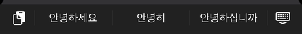
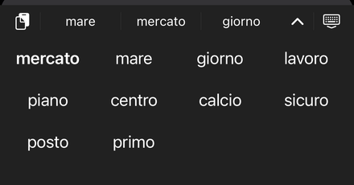

# TsumuKey

An iOS keyboard for people who type in several languages at once.
*Tsumugi* (紡ぎ) is Japanese for weaving thread: TsumuKey weaves your
languages into one keyboard, with no switching. Everything runs on the phone.

## See it

<p align="center"></p>

*"hello wrold" becomes "Hello world.", "sushi" offers 🍣, Italian words switch the
bar to Italian, a long press lists more words, romaji turns into 私は日本語を話す with one
tap, and the same keys spell 안녕하세요 on the Korean keyboard.*

### Two languages at once

Pick any two of English, French, German, Spanish, Italian and Portuguese. The bar mixes them as you type;
the ones you turned off stay out of the way.

With **Detect Language** on (the default), list as many of the six as you like:
autocorrect knows the words of all of them, and the bar follows the two you're
typing, judged from your last dozen or so words. The space bar shows which two.

| Languages | You type | Bar |
|---|---|---|
| German + English | Ich habe heute keine _ |  |
| Spanish + English | Quiero comer una manz_ |  |
| English + French | Ich wohne in einer kleinen Wohnu_ |  |

The last row is German typed with German turned off: no German suggestions.

### Japanese in the Latin keyboard

Type romaji and the red chip offers the Japanese; tap it to swap. Words that are
English or French put it last instead of first.

| You type | Bar |
|---|---|
| watashi |  |
| nihongowohanasu |  |
| gomen |  |

⌄ at the end of the bar, or a long press on the red word, opens more conversions in
place of the keys. A kana flick pad and a romaji keyboard are there too, converted with
azooKey.

### Korean

Pick 한국어 as the other alphabet (Layouts) and a Hangul keyboard joins the menu:
두벌식 (Dubeolsik) or the 12-key 천지인 (Cheonjiin), jamo joined into syllables as you type.
The bar completes words, and autocorrect reads where your finger landed, as on the
Latin keys.

| You type | Bar |
|---|---|
| 안녕 |  |

On the Latin keyboard, romanised Korean (annyeong, gamsahamnida) offers the Hangul in
the red chip. On the Hangul keyboard, the keys under the Latin letters still spell your
European words (ㅗㄷㅣㅣㅐ offers "hello").

### Layouts, symbols, menu

| Hold ⚙︎: your layouts | Hold A: its symbol right above, accents next to it |
|---|---|
|  |  |

Nine layouts: QWERTY, AZERTY, QWERTZ, Colemak, Dvorak, Bépo, Workman, Norman and
Maltron. Keep up to three in the menu, the first is the default; hold one in the app
to see its keys. Every key carries a symbol in its corner and long-press puts it
under your finger, accents next to it.

### More words, emoji

| Hold a word in the bar: the likely alternatives |
|---|
|  |

A long press on any word in the bar swaps the keys for a grid of the words that fit,
the pressed one first; ⌃ closes it. A word that names an emoji ("pizza", "hund",
"merci") offers it in the last slot of the bar; a tap adds it after the word.

### Also

- **Tap-aware corrections.** A tap is a point, not a letter: each candidate is
  scored on where your finger landed plus how likely the word is in context.
- **Learns your words.** Undo an autocorrection with backspace and that word is
  never corrected again ("mcp" stays "mcp").
- **Punctuation sticks to the word**: "word ." becomes "word." once you type the next
  space.
- **Looks**: Day, Night (Gboard's colours) or Match iPhone; colour letters by row,
  by thumb or vowels, brightened automatically in dark mode.
- **On device.** Nothing you type leaves the phone.

## Scores

### Typing accuracy against the iOS keyboard

The same simulated taps, typed back to back on the iOS keyboard (English & French)
and on TsumuKey (QWERTY, iPhone 16 Pro Max, 70 English, French and mixed sentences,
606 words).

| Typing | iOS keyboard | TsumuKey |
|---|---|---|
| Careful | 92.1% words right | **95.0%** |
| Fast | 75.9% | **77.9%** |

Korean on 두벌식, the same way against the iOS Korean keyboard: careful 85.6% →
**95.8%**, fast 49.2% → **81.8%**.

### On the phone

- Memory: 35–39 MB on an iPhone 15 (limit 76 MB), steady across 20 openings.
- Japanese conversion: 1–26 ms per word; the kana dictionary adds ~4 MB.

## Building

Requirements: macOS with Xcode 16, [XcodeGen](https://github.com/yonaskolb/XcodeGen),
cmake and ninja (`brew install xcodegen cmake ninja`), an Apple developer team
for signing.

```sh
Tools/build_llama_ios.sh          # once: builds llama.cpp from the Vendor/llama.cpp submodule
xcodegen generate                 # creates TsumuKey.xcodeproj from project.yml
open TsumuKey.xcodeproj           # set your team, then build and run on an iPhone
```

Then on the phone: Settings → General → Keyboard → Keyboards → Add New
Keyboard → TsumuKey, and turn on **Allow Full Access** so the keyboard can
read the app's settings.

Install Release builds: the decoder is about five times slower unoptimized.

### Sideloading

Each [release](https://github.com/Iito/TsumuKey/releases) has an unsigned IPA
for AltStore, SideStore and the like, which re-sign it with your Apple ID.
Releases marked pre-release (`-rc` tags) are test builds of the next version.
They're built by `.github/workflows/ipa.yml` (`Tools/make_ipa.sh` locally).

### Models and word list

The app ships the word list (`Models/lexicon-eu6.bin`), the small correction
model (`Models/ranker-*.rank`), the language detector (`Models/langid.tkl`) and
the Korean word lists (`Models/words-ko.txt`, `Models/lexicon-ko.bin`). Gemma 3 is downloaded from the
app, from [Hugging Face](https://huggingface.co/iito-sama/tsumukey-models).

`Tools/build_llama_ios.sh` builds llama.cpp (a submodule pinned to b12063)
as CPU-only static libraries into `Vendor/llama-cpu`, which isn't in git:
Metal alone would use ~45 MB of the keyboard's ~76 MB memory limit.

## Project layout

| Folder | What's in it |
|---|---|
| `App/` | The container app: settings, the "Try it here" field |
| `Keyboard/` | The keyboard extension: layouts, touch handling, decoder, model |
| `Shared/` | Settings shared by the app and the keyboard |
| `UITests/` | On-device tests, typing benchmark, screenshot and demo runs |
| `Models/` | Word lists, the small correction model, the language detector |
| `Tools/` | llama.cpp build script and module map, icon generator |
| `Vendor/` | llama.cpp (submodule) |

See `CHANGELOG.md` for what changed in each build.

## Third-party components

| Component | Licence |
|---|---|
| [llama.cpp](https://github.com/ggml-org/llama.cpp) (`Vendor/llama.cpp`, submodule) | MIT |
| [AzooKeyKanaKanjiConverter](https://github.com/azooKey/AzooKeyKanaKanjiConverter) (Swift package, [patched fork](https://github.com/Iito/AzooKeyKanaKanjiConverter/tree/tsumukey)) | MIT |
| azooKey's dictionary (inside the converter) | Apache 2.0 |
| [Gemma 3 270M](https://ai.google.dev/gemma) (downloaded) | [Gemma Terms of Use](https://ai.google.dev/gemma/terms) |
| Word frequencies from [wordfreq](https://github.com/rspeer/wordfreq) (`Models/lexicon-*.bin`) | Apache 2.0 (code); data under CC BY-SA 4.0 |
| Korean word counts from [FrequencyWords](https://github.com/hermitdave/FrequencyWords) (OpenSubtitles 2018 and 2016; `Models/words-ko.txt`, `Models/lexicon-ko.bin`) | CC BY-SA 4.0 |
| Language detector (`Models/langid.tkl`), built from [Tatoeba](https://tatoeba.org) sentences | CC BY 2.0 FR |

## Licence

TsumuKey's own code is under the MIT licence; see [LICENSE](LICENSE). Bundled third-party code, data and the model keep their own licences (table above).
