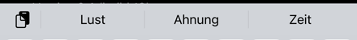
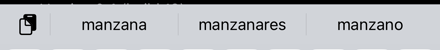
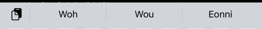
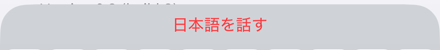
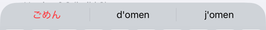
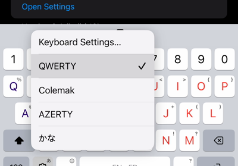
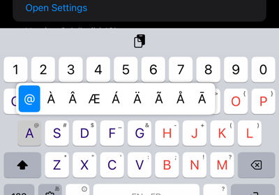
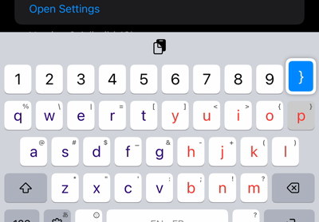

# TsumuKey

An iOS keyboard for people who type in several languages at once.
*Tsumugi* (紡ぎ) is Japanese for weaving thread: TsumuKey weaves your
languages into one keyboard, with no switching. Everything runs on the phone.

## See it

<p align="center"></p>

*"hello wrold" becomes "Hello world.", romaji turns into 私は日本語を話す with one tap,
123 opens a numpad (hold it for symbols), then Colemak, QWERTZ and Dvorak.*

### Two languages at once

Pick any two of English, French, German and Spanish. The bar mixes them as you type;
the ones you turned off stay out of the way.

| Languages | You type | Bar |
|---|---|---|
| German + English | Ich habe heute keine _ |  |
| Spanish + English | Quiero comer una manz_ |  |
| English + French | Ich wohne in einer kleinen Wohnu_ |  |

The last row is German typed with German turned off: no German suggestions.

### Japanese in the Latin keyboard

Type romaji and the red chip offers the Japanese; tap it to swap. Words that are
English or French put it last instead of first.

| You type | Bar |
|---|---|
| watashi |  |
| nihongowohanasu |  |
| gomen |  |

A kana flick pad and a romaji keyboard are there too, converted with azooKey.

### Layouts, symbols, menu

| Hold ⚙︎: your layouts | Hold A: its symbol right above | Hold P near the edge |
|---|---|---|
|  |  |  |

QWERTY, Colemak, AZERTY, QWERTZ and Dvorak; keep up to three in the menu, the first
is the default. Every key carries a symbol in its corner and long-press puts it
under your finger, accents next to it.

### Also

- **Tap-aware corrections.** A tap is a point, not a letter: each candidate is
  scored on where your finger landed plus how likely the word is in context.
- **Learns your words.** Undo an autocorrection with backspace and that word is
  never corrected again ("mcp" stays "mcp").
- **Punctuation sticks to the word**: "word ." becomes "word.".
- **Looks**: Day, Night (Gboard's colours) or Match iPhone; colour letters by row,
  by thumb or vowels, brightened automatically in dark mode.
- **On device.** Nothing you type leaves the phone.

## Scores

### Typing accuracy against Gboard

Same simulated taps (noise measured from real taps on the phone) typed on Gboard
and on this keyboard, Colemak, iPhone 15, 70 English, French and mixed sentences.

| Typing | Gboard | TsumuKey |
|---|---|---|
| Careful | 85.5% words right | **90.6%** |
| Fast | 65.3% | **66.7%** |

### Gemma 3 270M, before and after cutting its vocabulary

The full model's 262k-token vocabulary alone needs ~55 MB on an iPhone, more than
a keyboard's 76 MB limit allows next to everything else, so the vocabulary is cut
to the tokens these languages use. Bits per character on held-out Wikipedia and
Tatoeba text (lower is better):

| Model | Vocabulary | English | French | EN+FR mixed |
|---|---|---|---|---|
| Gemma 3 270M (QAT, Q4_0) | 262k | 1.089 | 1.252 | 1.739 |
| Cut to English + French | 32k | 1.271 | 1.326 | 1.774 |
| Cut to English + French | 48k | 1.176 | 1.281 | 1.750 |
| **Cut to EN + FR + DE + ES (shipped)** | **64k** | *pending* | *pending* | *pending* |

German and Spanish scores for the shipped model are being measured.

### On the phone

- Memory: 35–39 MB on an iPhone 15 (limit 76 MB), steady across 20 openings (measured with the 48k model; the 64k one is expected to add ~6 MB).
- Japanese conversion: 1–26 ms per word; the kana dictionary adds ~4 MB.

## Building

Requirements: macOS with Xcode 16, [XcodeGen](https://github.com/yonaskolb/XcodeGen),
an Apple developer team for signing.

```sh
xcodegen generate                 # creates TsumuKey.xcodeproj from project.yml
open TsumuKey.xcodeproj           # set your team, then build and run on an iPhone
```

Then on the phone: Settings → General → Keyboard → Keyboards → Add New
Keyboard → TsumuKey, and turn on **Allow Full Access** so the keyboard can
read the app's settings.

Install Release builds: the decoder is about five times slower unoptimized.

### Regenerating the model and word list

The repository ships the files the keyboard uses
(`Models/gemma-3-270m-enfrdees64k-Q4_0.gguf`, `Models/lexicon-enfrdees.bin`).
To rebuild them:

- `Tools/prune_vocab.py`: cuts Gemma 3 270M's 262k-token vocabulary down to
  the tokens a corpus uses (64k for the four languages), so it fits an iOS
  keyboard's memory limit.
- `Tools/build_lexicon.py`: builds the word list from
  [wordfreq](https://github.com/rspeer/wordfreq), with one frequency per
  language.
- `Tools/build_llama_ios.sh`: builds llama.cpp as CPU-only static libraries
  into `Vendor/llama-cpu`.

## Project layout

| Folder | What's in it |
|---|---|
| `App/` | The container app: settings, the "Try it here" field |
| `Keyboard/` | The keyboard extension: layouts, touch handling, decoder, model |
| `Shared/` | Settings shared by the app and the keyboard |
| `UITests/` | On-device tests, typing benchmark, screenshot and demo runs |
| `Models/` | Language model and word list |
| `Tools/` | Scripts that build the model, word list and llama.cpp |
| `Vendor/` | llama.cpp static libraries, azooKey |

See `CHANGELOG.md` for what changed in each build.

## Third-party components

| Component | Licence |
|---|---|
| [llama.cpp](https://github.com/ggml-org/llama.cpp) (`Vendor/llama-cpu`) | MIT |
| [AzooKeyKanaKanjiConverter](https://github.com/azooKey/AzooKeyKanaKanjiConverter) (`Vendor/AzooKeyKanaKanjiConverter`) | MIT |
| azooKey's dictionary (inside the converter) | Apache 2.0 |
| [Gemma 3 270M](https://ai.google.dev/gemma) (`Models/*.gguf`, pruned) | [Gemma Terms of Use](https://ai.google.dev/gemma/terms) |
| Word frequencies from [wordfreq](https://github.com/rspeer/wordfreq) (`Models/lexicon-*.bin`) | Apache 2.0 (code); data under CC BY-SA 4.0 |

## Licence

TsumuKey's own code is under the MIT licence; see [LICENSE](LICENSE). Bundled third-party code, data and the model keep their own licences (table above).
